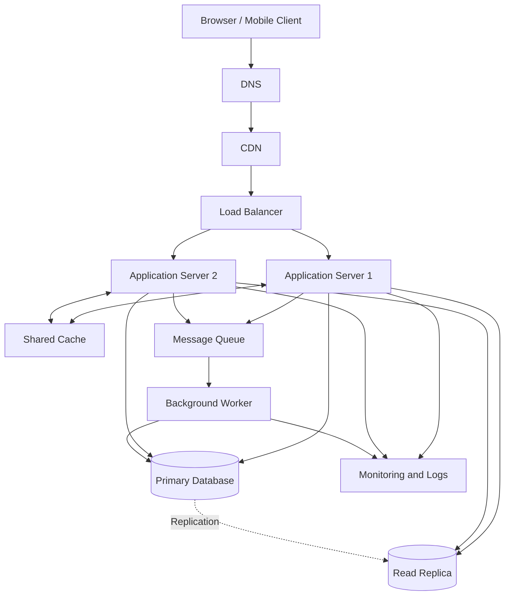

# QuickNotes System Architecture

## 1. Overview

QuickNotes is a notes application designed to grow from a browser-based application into an online service supporting one million registered users.

The proposed architecture separates the client, application servers, database, cache, and background processing. It aims to provide good performance, reliability, security, and room for future growth.

## 2. Functional Requirements

The system must:

1. Allow users to register, log in, and log out.
2. Allow authenticated users to create, view, update, and delete notes.
3. Allow users to organize notes using tags.
4. Ensure users can access only their own notes.
5. Support searching and paginating through notes.
6. Display clear success, loading, empty, and error states.
7. Keep notes persistent after users close or refresh the application.

## 3. Non-Functional Requirements

- **Scalability:** Support one million registered users and allow application capacity to increase as demand grows.
- **Availability:** Target 99.9% monthly availability, subject to infrastructure and operational requirements.
- **Performance:** Target a 95th-percentile response time below 300 ms for ordinary reads under normal load, excluding network delays outside the service.
- **Security:** Use HTTPS, secure password hashing, authentication, authorization, and input validation.
- **Reliability:** Back up the database and use replication and recovery procedures.
- **Consistency:** Ensure successful note changes are durably stored before confirming success.
- **Maintainability:** Use modular application code, monitoring, automated tests, and centralized logs.

## 4. Load Estimates for One Million Users

### Assumptions

- 1,000,000 registered users.
- 10% of registered users are active daily: 100,000 daily active users.
- Each daily active user reads 20 notes per day.
- Each daily active user creates 2 notes per day.
- Each note occupies approximately 2 KB of stored content and basic metadata.
- A peak-to-average multiplier of 5 is used for planning.
- A year has 365 days.

### Reads per second

Daily reads:

100,000 users × 20 reads = 2,000,000 reads per day.

Average reads per second:

2,000,000 ÷ 86,400 ≈ 23 reads per second.

Estimated peak:

23 × 5 ≈ 116 reads per second.

### Writes per second

Daily writes:

100,000 users × 2 notes = 200,000 notes per day.

Average writes per second:

200,000 ÷ 86,400 ≈ 2.3 writes per second.

Estimated peak:

2.3 × 5 ≈ 12 writes per second.

These write estimates cover note creation only; updates, deletes, tags, and other database operations add extra load.

### Storage per year

Annual note creation:

200,000 × 365 = 73,000,000 notes.

Annual raw storage:

73,000,000 × 2 KB ≈ 146 GB per year.

Allowing approximately twice the raw storage for indexes and database overhead gives an initial estimate of about **292 GB per year**.

This estimate excludes backups, replicas, logs, media attachments, and additional growth. Actual storage should be measured and revised as usage becomes clearer.

## 5. Architecture Diagram

The primary database handles writes, while the read replica serves suitable read queries. Replication is asynchronous in this design, so a replica can briefly lag behind the primary.

The application servers are stateless so requests can be handled by either server.

## 6. Components and the Problems They Solve

| Component | Purpose |
|---|---|
| Browser / Mobile Client | Provides the user interface for creating and managing notes. |
| DNS | Resolves the service's domain name to its network entry point. |
| CDN | Caches static assets closer to users, reducing latency and origin traffic. |
| Load Balancer | Distributes incoming requests across healthy application servers. |
| Application Servers | Execute API logic, validate requests, authenticate users, and enforce authorization. |
| Shared Cache | Stores frequently accessed data temporarily to reduce database reads and response times. |
| Primary Database | Stores authoritative user, note, tag, and relationship data and handles writes. |
| Read Replica | Offloads suitable read queries from the primary database. |
| Message Queue | Buffers background jobs so slow tasks do not block ordinary API requests. |
| Background Worker | Processes jobs such as notifications, cleanup, and other asynchronous tasks. |
| Monitoring and Logs | Tracks errors, latency, resource usage, and service health for troubleshooting. |

## 7. GET /notes Request Flow

1. The user opens the application and requests their notes.
2. DNS resolves the service domain, and the request reaches the CDN and load balancer.
3. The load balancer forwards the API request to a healthy application server.
4. The application server validates the access token and identifies the user.
5. The application checks the shared cache for the user's requested notes.
6. On a cache hit, the application returns the cached result after validating its authorization and freshness requirements.
7. On a cache miss, the application reads the notes from the read replica when replica consistency is sufficient.
8. If a fresh read is required, or the replica is unavailable, the application uses the primary database according to the fallback policy.
9. The application returns the notes as JSON, and the client renders them.

The query must always restrict results to the authenticated user's ID. Pagination limits response size, and cache keys must include the user identity to prevent cross-user data leaks.

## 8. POST /notes Request Flow

1. The client submits the note title and optional body over HTTPS.
2. DNS, the CDN, and the load balancer route the request to a healthy application server.
3. The application validates the access token and checks that the title is present and does not exceed 100 characters.
4. The application derives the owner ID from the authenticated identity rather than trusting an owner ID supplied by the client.
5. The application inserts the note into the primary database and commits the transaction.
6. Only after the database confirms the commit does the API return `201 Created` with the new note's ID and representation.
7. The application invalidates or updates relevant cache entries so subsequent reads do not return stale data.
8. If follow-up work is needed, the application publishes a job to the message queue. The worker processes it independently and retries transient failures safely.

The note must not be acknowledged as successfully created before its database transaction commits. If publishing a background job is essential to the correctness of a write, a transactional outbox can be used to avoid losing the job between the database commit and queue publication.

## 9. Trade-Offs

### Trade-off 1: Cache performance versus freshness

A cache reduces repeated database reads and can lower response times. However, cached notes may become stale after an update or deletion.

**Decision:** Use a short time-to-live and invalidate affected entries after successful writes. For read-after-write behavior, read from the primary database or use a consistency-aware strategy when necessary.

### Trade-off 2: Read replicas versus consistency

Read replicas distribute read traffic and reduce pressure on the primary database. However, asynchronous replication can cause users to briefly see older data.

**Decision:** Use replicas for ordinary reads where slight delay is acceptable. Use the primary database for operations that require immediately consistent results.

### Trade-off 3: Background processing versus operational complexity

A queue prevents slow background work from delaying API responses. However, queues and workers introduce retries, duplicate delivery, and additional infrastructure to operate.

**Decision:** Use the queue for non-critical asynchronous tasks, make jobs idempotent, monitor queue depth, and configure retry limits and dead-letter handling.

### Trade-off 4: More infrastructure versus cost

Multiple application servers, database replication, caching, and queues improve scalability and resilience but increase cost and operational complexity.

**Decision:** Deploy only the capacity justified by measured demand, automate scaling where appropriate, and review resource usage regularly.

## 10. Avoiding Single Points of Failure

- **Application servers:** Run at least two instances across separate failure domains and configure health checks so unhealthy instances stop receiving traffic.
- **Load balancer:** Use a managed or redundant load-balancing service rather than relying on one manually maintained server.
- **Database:** Use managed high availability or a standby primary with automated failover, plus tested backups and point-in-time recovery.
- **Read replica:** Monitor replication lag and provide a fallback to the primary for appropriate reads if the replica fails.
- **Cache:** Use a highly available shared cache where required, with a database fallback and sensible timeouts.
- **Queue and workers:** Use durable queue storage, multiple worker instances, retries, and dead-letter handling.
- **DNS and CDN:** Use reliable managed providers and appropriate health, caching, and failover configuration.
- **Monitoring:** Alert on failures, latency, storage growth, replication lag, and queue backlog.

Redundancy reduces the impact of individual component failures, but it does not guarantee uninterrupted service. Recovery procedures, regular failover tests, backups, and operational monitoring remain necessary.

## 11. Conclusion

This architecture provides a starting point for growing QuickNotes to one million registered users. Stateless application servers, caching, read replicas, and background processing separate different workloads and provide room to scale.

The estimates are planning assumptions rather than measured results. Before production deployment, the team should validate them with load tests, monitor real usage, and adjust database capacity, cache policies, and infrastructure according to observed bottlenecks.
