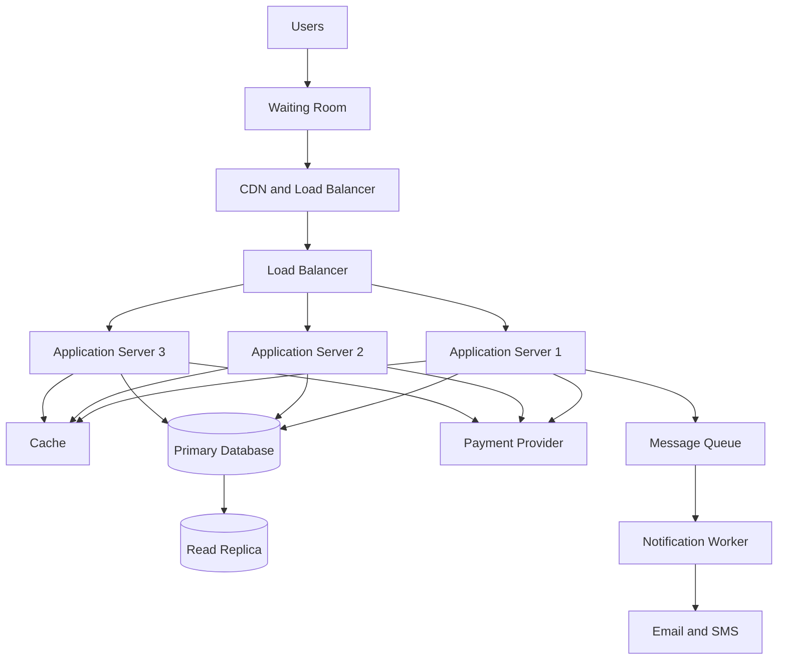

# TicketHub System Design

## 1. Requirements

TicketHub is a website where users can browse concerts and events, select seats, purchase tickets and view their purchased tickets.

### Functional requirements

The system must allow users to:

1. Register, log in and manage their accounts.
2. Browse upcoming events and search by name, location or date.
3. View event details, including venue, date, price and available seats.
4. Select seats and temporarily hold them while completing payment.
5. Pay for held seats and receive confirmation.
6. View their purchased tickets and order history.

### Non-functional requirements

- **Speed:** Event pages and seat availability should load quickly, even during popular ticket sales.
- **Correctness:** A seat must never be sold to two different customers.
- **Fairness:** Users should have a fair opportunity to purchase tickets. The system should use a waiting room during very popular sales and process users in an orderly manner.
- **Availability:** The website should remain accessible during high traffic.
- **Security:** User accounts and payment information must be protected.
- **Scalability:** The system should handle sudden increases in visitors without crashing.

## 2. Traffic Estimates

TicketHub has 2 million registered users.

### Normal traffic

On a normal day:
- 50,000 people visit the website.
- Each visitor views 10 pages.
- Total page views = 50,000 × 10 = 500,000 page views per day.
- Average page requests per second = 500,000 ÷ 86,400 = approximately 5.8 requests per second.
- 5,000 tickets are sold per day.

### Big sale traffic

When a popular concert goes on sale:
- 200,000 people attempt to buy tickets.
- Only 20,000 seats are available.
- The activity happens within the first 10 minutes.
- Average purchase attempts per second = 200,000 ÷ 600 = approximately 333 attempts per second.

### Comparison

The big sale creates a much higher demand than normal operations. There are ten potential buyers for every available seat.

The system must handle simultaneous requests, prevent double-booking and control traffic using a waiting room. It should also use caching and additional application servers to handle increased demand.

## 3. API Design

The API allows the frontend website to communicate with the backend server.

| Method | Endpoint | Purpose |
|---|---|---|
| GET | `/api/events` | Browse and search upcoming events. |
| GET | `/api/events/:id` | View details of a specific event. |
| GET | `/api/events/:id/seats` | View available, held and sold seats. |
| POST | `/api/events/:id/holds` | Temporarily hold selected seats. |
| POST | `/api/orders` | Create an order for held seats. |
| POST | `/api/orders/:id/payment` | Process payment for an order. |
| GET | `/api/users/me/tickets` | View tickets belonging to the logged-in user. |

### Example seat-holding request

A user selects seats 12 and 13 for an event.

`POST /api/events/5/holds`

Request body:

```json
{
  "seat_ids": [12, 13]
}
```

The server checks whether both seats are available. If they are, it temporarily reserves them for the user for a limited period, such as five minutes.

If another user already holds either seat, the request fails and the user must select different seats.

### Example payment request

`POST /api/orders/25/payment`

Request body:

```json
{
  "payment_reference": "PAY12345"
}
```

The backend verifies the payment with the payment provider before confirming the order.

## 4. Data Model

The database will use four main tables: users, events, seats and orders.

### Users table

| Column | Data type | Description |
|---|---|---|
| user_id | INTEGER | Primary key |
| name | VARCHAR(100) | User's full name |
| email | VARCHAR(150) | Unique email address |
| password_hash | TEXT | Hashed password |

### Events table

| Column | Data type | Description |
|---|---|---|
| event_id | INTEGER | Primary key |
| event_name | VARCHAR(150) | Name of event |
| venue | VARCHAR(150) | Event location |
| event_date | DATETIME | Date and time |
| ticket_price | DECIMAL(10,2) | Ticket price |

### Seats table

| Column | Data type | Description |
|---|---|---|
| seat_id | INTEGER | Primary key |
| event_id | INTEGER | Foreign key referencing events |
| seat_number | VARCHAR(20) | Seat identifier |
| status | VARCHAR(20) | Available, held or sold |
| held_by | INTEGER | User holding the seat, nullable |
| hold_expires_at | DATETIME | Time when the hold expires |

A unique constraint on `(event_id, seat_number)` ensures that a seat number cannot be duplicated within the same event.

### Orders table

| Column | Data type | Description |
|---|---|---|
| order_id | INTEGER | Primary key |
| user_id | INTEGER | Foreign key referencing users |
| seat_id | INTEGER | Foreign key referencing seats |
| order_date | DATETIME | Date of purchase |
| payment_status | VARCHAR(20) | Pending, paid or failed |
| payment_reference | VARCHAR(100) | Unique payment reference |

### Relationships

- One user can make many orders.
- One event can have many seats.
- One seat belongs to one event.
- One order belongs to one user and references a seat.

The foreign keys maintain relationships between the tables and prevent invalid references.

## 5. Preventing Double-Booking

Double-booking happens when two people attempt to purchase the same seat at the same time.

TicketHub prevents this using database transactions, row-level locking and constraints.

### How it works

1. A user selects a seat and requests to hold it.
2. The backend starts a database transaction.
3. The database locks the selected seat using a row-level lock.
4. It checks whether the seat is available or whether an existing hold has expired.
5. If available, the system changes its status to `held`, records the user and sets a five-minute expiry time.
6. The transaction commits, making the hold visible to other requests.
7. Another user attempting to hold the same seat must wait for the lock. Once the first transaction commits, the second request sees that the seat is no longer available and is rejected.
8. After successful payment, the seat changes to `sold`.

If payment is not completed within five minutes, the hold expires and the seat becomes available again.

### Database protection

The system uses:
- **Transactions:** All seat-holding changes happen together. If something fails, the transaction rolls back.
- **Row-level locking:** Prevents two transactions from simultaneously changing the same seat.
- **Unique constraints:** Prevent duplicate seat numbers for the same event.
- **Conditional updates:** A seat can only change from available to held if it is still available.

This ensures that two customers cannot successfully purchase the same seat.

Payment requests should also use idempotency keys so that retrying a payment request does not create duplicate charges or orders.

## 6. Architecture

### Architecture diagram



### Explanation of components

1. **Users:** Customers accessing TicketHub through a browser or mobile device.
2. **Waiting room:** Controls traffic during popular sales and gives customers an orderly opportunity to enter.
3. **CDN:** Delivers static content such as images, CSS and JavaScript from servers closer to users.
4. **Load balancer:** Distributes incoming requests across multiple application servers.
5. **Application servers:** Handle event browsing, seat selection, orders and business logic. Multiple servers allow the system to handle more requests.
6. **Cache:** Stores frequently accessed information such as event details to reduce database queries.
7. **Primary database:** Stores users, events, seats and orders. All important seat reservations and purchases are handled here.
8. **Read replica:** Handles read-heavy operations, such as browsing event information, reducing pressure on the primary database.
9. **Payment provider:** Processes customer payments and returns payment confirmations.
10. **Message queue and notification worker:** Processes background tasks such as sending tickets, emails and SMS notifications.

### Surviving the big sale

During a popular concert sale, the waiting room controls the number of people entering the application. The load balancer distributes requests across several application servers.

The CDN and cache reduce repeated requests to the database. The read replica handles browsing traffic, while the primary database protects seat reservations and purchases using transactions and locks.

The message queue handles notifications in the background so that customers do not have to wait for emails or SMS messages before receiving their purchase confirmation.

## 7. Trade-offs

### 1. Strong consistency vs performance

Using database transactions and row-level locks protects against double-booking. However, locking can slow down requests when many customers want the same seats.

I choose correctness over maximum speed because selling the same seat twice would damage customer trust.

### 2. Waiting room vs immediate access

A waiting room reduces pressure on the application and database during popular sales. However, customers must wait before accessing tickets.

I choose a waiting room because controlled access is better than allowing the website to crash under heavy traffic.

### 3. Caching vs fresh information

Caching improves browsing speed and reduces database load. However, cached seat availability can become outdated.

Therefore, cached information can be used for event browsing, but the primary database must always verify seat availability before confirming a hold or purchase.

## 8. Reflection

The most important design principle is that the system must prioritize correctness when handling ticket purchases. A fast system is not useful if it sells the same seat to multiple people.